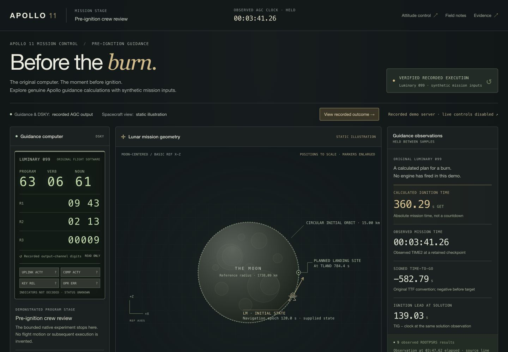

# Frontend mission-control MVP — validation and delivery

**COMPLETE AND VERIFIED for the frontend scope, 2026-10-18.** This implements the
requested frontend milestone. Backend Phase 11 propulsion and dynamics were not
started. The application displays recorded authentic calculations and synthetic
static geometry; it does not demonstrate a flight or landing.

## Checkout and launch

Work is isolated on `codex/frontend-mission-control`, based on
`5a689c75d43613f29a49fa32d9bd786437825ee5`, in the repository's
`.build/frontend-mission-control` Git worktree. The original `main` checkout
remains unchanged and clean. No commit, push or merge was performed.

From the isolated checkout root:

```sh
make demo PORT=4182
```

Open `http://127.0.0.1:4182/guidance.html`. This server is running for delivery.
Python 3.9+ is sufficient; there is no browser bundle build or runtime npm
installation. All assets are local. Ctrl-C stops a server you started.

The existing live attitude application is preserved at `/`. To enable its actual
bounded yaw/pitch controls, start `python3 -B frontend/serve.py --port 4183` and
open `http://127.0.0.1:4183/`. The new mission-control screen uses recordings even
when that separate capability is available. Neither entry point exposes live P27
mission initialization or arbitrary P63/DSKY commands.

## Implemented experience

- Apollo-inspired three-column desktop workbench: original recorded DSKY digits,
  prominent static lunar geometry and guidance observations. The phone layout
  prioritizes geometry before dense telemetry.
- Mission stage, sampled/held AGC clock, visible recorded execution mode and a
  separate static-illustration label. Unknown DSKY sign/indicator states remain
  explicitly unknown; no lights or key-command responses are synthesized.
- Select the three retained scenarios, view their final outcomes immediately,
  play/pause, restart, scrub, change replay speed and step through real events.
- Compare **completed recordings**, clearly separate from the current replay
  position. A: TIG 360.29 s GET; B: 360.44 s GET; C: no completed ignition time,
  three provisional root observations and original 01406.
- Twelve accessible educational explanations connecting navigation, alignment,
  original guidance, ignition timing and physical feedback. Thrust is explained
  conceptually without displaying nonexistent propulsion telemetry.
- Exactly three planned crew roles: Armstrong and Aldrin in the Lunar Module,
  Collins in the Command Module/lunar orbit. Human/AI participation and crew
  communications remain unavailable.
- RecordedTraceProvider supplies immutable typed snapshots with per-field source,
  units, coordinate frame, epoch and availability. LiveBackendProvider performs
  read-only discovery through existing APIs; it starts no AGC and sends no
  commands. Capability availability never changes recorded guidance into live
  execution.
- An independent SVG renderer consumes initialized 3D state. It neither propagates
  an orbit nor animates a descent. Spacecraft epoch 120 s and planned site epoch
  TLAND 784.4 s remain separate. Positions use a consistent projection scale;
  vehicle/site markers and velocity-arrow length are illustrative.

See [architecture](FRONTEND_ARCHITECTURE.md) and
[integration contract](FRONTEND_INTEGRATION_CONTRACT.md) for the actual API table,
typed models, source boundaries, missing interfaces and future integration plan.

## Source and preservation

The original Luminary rope remains SHA-256
`1f5326e038de5b741b2f27b01ec949dbd688cf1906994e997402587c8628f40e`.
The verified browser recording remains SHA-256
`36d380a5274312621145d3549a161fea7040d269c549738239ac4e7dabf52709`.
The original exporter and all recorded data are unchanged.

The new preservation receipt covers **5,509 existing files**, including every
historical report/evidence file, the backend, original attitude modules and
recordings. All match their pre-work hashes. Original Apollo source, emulator
semantics, spacecraft/sensor models and backend behavior were not modified.
Only three pre-existing files changed: frontend README, guidance HTML and its
controller. Drawing code moved from that controller into a reusable renderer;
its static projection and missing-site behavior have focused tests.

Historical Phase 10.5 manifests intentionally describe the old frontend. They
were not rewritten to approve this new screen. Its full old application-package
guard is NOT RUN as a gate for these authorized frontend edits. Historical data
and reports are independently protected by the new inventory; new application
hashes are captured by the focused test runner and final package inventory.

## Actual checks

The final focused run passed **133 tests**, with **0 failures, 0 errors and
0 skips**, plus strict TypeScript checking and artifact/preservation verification:

| Check | Actual result |
|---|---:|
| Node presentation/provider/viewer tests | 60 passed |
| Existing backend unit/HTTP tests | 32 passed |
| Existing recorded attitude data tests | 12 passed |
| Existing recorded guidance data tests | 14 passed |
| Existing portable-launcher guard tests | 6 passed |
| Existing retained live evidence tests | 9 passed |
| TypeScript 5.9.3, strict, noEmit | Exit 0 |
| Existing demo artifact/export verification | Exit 0 |
| Protected historical/backend/source files | 5,509 unchanged |

Portable developer commands:

```sh
npm --prefix frontend ci
npm --prefix frontend run typecheck
npm --prefix frontend test
python3 -B docs/frontend-evidence/run_checks.py --output .build/frontend-checks/new-run
python3 -B docs/frontend-evidence/check_integrity.py
```

This host has a bundled Node 24.19.0 runtime but no npm executable. The compiler
was obtained from the official npm registry at pinned TypeScript 5.9.3, verified
against its SHA-512 registry integrity, and executed directly. No npm install/ci
run is claimed. The package lock records that exact package/integrity for normal
npm-equipped development environments. Browser launch needs neither compiler nor
npm. Actual host-specific Node/compiler arguments, environment and raw logs are
retained in [runs/verified](frontend-evidence/runs/verified/record.json); these
captured paths are evidence, not application configuration.

The exact focused command executed was:

```sh
python3 -B docs/frontend-evidence/run_checks.py \
  --node /Users/ggtrinkalipu/.cache/codex-runtimes/codex-primary-runtime/dependencies/node/bin/node \
  --tsc /Users/ggtrinkalipu/Documents/hacktoberfest-apollo/.build/typescript-5.9.3/package/lib/tsc.js \
  --output .build/frontend-checks/verified
```

The earlier development run passed 131 tests. Browser QA then exposed a native
Window.fetch receiver binding bug in backend discovery. The default transport
now preserves the browser receiver and injected transports are invoked without a
provider-bound receiver. Two regression tests were added, and the entire focused
suite reran successfully at 133 tests. Both raw test runs are retained; only the
final run describes the delivered source.

## Actual browser checks

[Browser observations](frontend-evidence/browser-checks.json) distinguish the
initial development observation from final validation. Final checks verified:

- A/B/C recorded outcomes, unchanged signed TTF, absolute TIG and held solution
  lead; no landing-site marker or ignition solution invented for C.
- Play/pause, restart, stepping, speed selection, keyboard seeking and Escape to
  close a dialog. The static craft transform remains fixed during playback.
- Desktop 1440 px, tablet 1024 px and phone 390 px viewports, with actual
  `innerWidth`/scroll width readbacks and no page-wide horizontal overflow. The
  mobile comparison dialog fits within 356 px. These are responsive viewport
  checks, not claims of testing physical phones or AR hardware.
- Exactly three crew cards, Collins explicitly in lunar orbit, unavailable
  participation and no fabricated crew activity.
- Real GET bootstrap/status discovery on the replay-only server; it correctly
  reports disabled live attitude while keeping recorded guidance available.
- A dedicated **UI fault fixture** returns HTTP 503 for the first recording
  request and HTTP 404 for backend APIs. The screen clears values/geometry,
  disables controls and shows the actual error. Retry loads the unchanged real
  dataset, restores TIG 360.29 s GET and nine observed roots, and remains usable
  without a backend. The fixture emits no AGC output or fake mission state.
- No warning/error console messages in the final normal application tab. Expected
  HTTP errors belong only to the explicitly labeled fault fixture.



[Full desktop screen](frontend-evidence/screenshots/desktop-full.png),
[phone layout](frontend-evidence/screenshots/mobile-overview.png),
[phone comparison](frontend-evidence/screenshots/mobile-comparison.png),
[recording unavailable](frontend-evidence/screenshots/recording-unavailable.png).

The fault fixture was stopped after verification. The normal demo remains on 4182.

## Limits and next integration steps

No new native AGC experiment was run in this frontend milestone. The exporter
checks the sealed Phase 10 evidence and the UI reads those exact results. UI
success is not evidence of new original-software execution or a flight simulation.

The three historical missing-log preservation errors remain unresolved. Their
full historical suites were NOT RUN here; none is reclassified as passing. The
previous source audit also found an existing HTTP-validator assertion that rejects
earlier wall-watchdog neutralization when it expects the later native-cycle
neutral event; that issue was reproduced before/after Phase 10. It was neither
rerun nor changed by this frontend work. Backend unit HTTP tests and retained
live-evidence checks are distinct from that native experiment.

Live Phase 10 guidance, arbitrary DSKY commands, calibrated flight alignment,
propulsion, translational dynamics, radar, landing, multiplayer and AI participants
remain unavailable. Optional Three.js/AR/RealityKit/USDZ work was deferred to keep
the core application lightweight and authentic.

Next: agree a versioned backend mission-snapshot/capability contract; connect actual
future propulsion/navigation samples only when validated; decode complete DSKY
lamp/sign states from verified outputs before adding key controls. Rendering and
crew features can then evolve behind real capability discovery. No backend
propulsion milestone was started.
