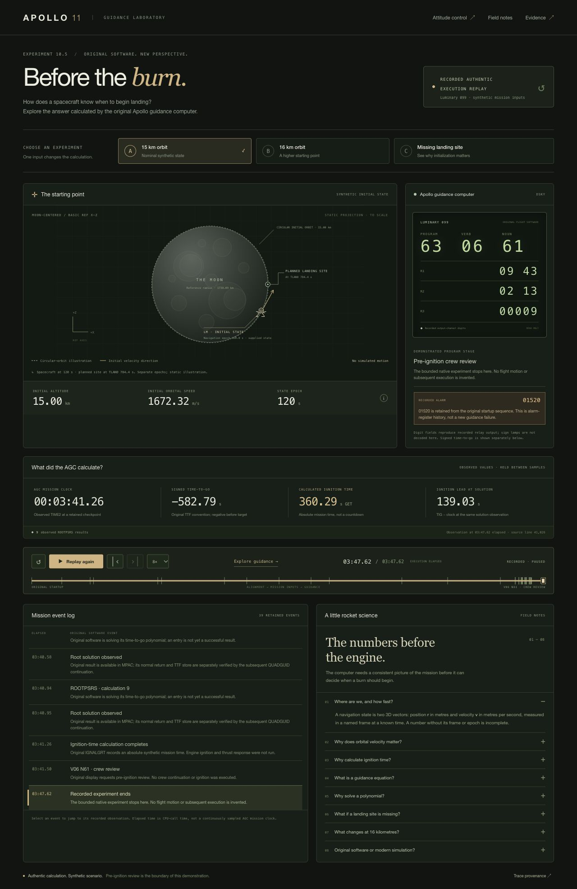

# Phase 10.5 — Stabilization and educational MVP

**Status: COMPLETE AND VERIFIED within the recorded, synthetic pre-ignition scope.**
Original Phase 10 numerical guidance was reproduced with unchanged flight software,
and the educational application was exercised in a real browser. No engine ignition,
powered descent, landing, or Phase 11 implementation is claimed.

## Baseline and preservation

Work began on `main`, HEAD `6859637ae8dcb1041db3944489d0f909ed58429f`.
The Phase 10 report and its evidence were already untracked user work. They were
fingerprinted before edits and preserved. No commit, push, reset or history rewrite
was performed. [The initial inventory](phase10_5-evidence/baseline.json) records
4,838 existing files; [the protected documentation inventory](phase10_5-evidence/prior-evidence.json)
contains 4,809 existing report/evidence files. Final comparison is in
[the preservation receipt](phase10_5-evidence/preservation-after.json).

The unchanged scientific record remains [Phase 10](PHASE10_MISSION_INITIALIZATION.md).
Its sealed package contains 739 files and its manifest SHA-256 is
`10b77abb67914dd6e0f4a13afb967b67f8e96b161217b63f9b0706f9a78fa7cc`.
Pinned Virtual AGC revision: `f577e3fd917866c59334e6cdd32504f09df76f60`.
Luminary 099 rope SHA-256:
`1f5326e038de5b741b2f27b01ec949dbd688cf1906994e997402587c8628f40e`.
The new launcher rejects a changed seal, source artifact or canonical raw trace.

## What users can do

Open `/guidance.html` to explore three retained experiments:

| Scenario | Actual original-software result | Classification |
|---|---|---|
| A: synthetic 15 km orbit | Nine normal ROOTPSRS returns; TIG 360.29 s GET; V06N61 | VERIFIED bounded numerical guidance |
| B: synthetic 16 km orbit | Nine normal ROOTPSRS returns; TIG 360.44 s GET; V06N61 | VERIFIED changed-input response |
| C: missing landing-site load | Three provisional root results, then original 01406; no completed ignition-time solution | VERIFIED negative control |

Users can select scenarios, play/pause, restart, scrub, change replay speed and
step through retained events. The initial view jumps to the recorded P63-selection
checkpoint; Restart exposes the complete startup/alignment/input history. The DSKY
can still show the preceding relay display at a checkpoint because its updates are
asynchronous. It is never overwritten with a desired program display.

The screen includes original DSKY digits, recorded alarms and program stages,
signed time-to-go, absolute ignition time, a static Moon/state projection, source
fingerprints, and eight short explanations of vectors, orbital speed, ignition
timing, guidance equations, polynomial roots, missing inputs, changed conditions
and the boundary between original software and modern simulation.

The existing attitude interface at `/` and its separate live-control adapter remain
available. Launching this MVP disables that server's native control API. The new
screen has no mission-parameter submission or live-guidance controls.

## Architecture and data provenance

```text
Unchanged Luminary 099 → pinned native emulator / ringbuffer
    → original Phase 9/10 harnesses → captured JSONL and native checkpoints
    → hash-checked read-only exporter → guidance.json → browser replay
```

`frontend/tools/export_guidance.py` reuses the retained Phase 10 analyzer and the
original output-channel DSKY decoder. It checks the entire Phase 10 seal, rope,
compressed/raw traces, observer map, configuration and original execution
assertions. It does not execute a replacement guidance algorithm. Independent
host floating-point diagnostics are validated by the original mathematical checks;
platform `sqrt`/`acos` diagnostic JSON need not be byte-identical. Actual native
trace comparisons and flight-value checks remain exact.

The three source traces are under `docs/phase10-evidence/runs/final-validation/`.
The deterministic derivative is `frontend/dist/data/guidance.json` (2,736,537 bytes),
SHA-256 `36d380a5274312621145d3549a161fea7040d269c549738239ac4e7dabf52709`.
[The data contract](phase10_5-evidence/data-contract.json) specifies field scales,
source pointers and limits. Each observation includes its actual CPU cycle and
one-based decompressed raw-trace line. Numeric displays hold preceding observations;
no AGC values or execution events are interpolated.

Important distinctions:

- **RECORDED AUTHENTIC EXECUTION REPLAY:** all new screen telemetry. Playback does
  not run the AGC. Fresh native reproduction is a separate command.
- **AGC-computed:** P51 matrix/flag, original P27 accepted stores, guidance roots,
  original TIG calculation, display relay words and alarm registers.
- **SYNTHETIC inputs:** orbit, mission epoch, site geometry, stationary instrument
  fixture and synthetic star sightings. Published target padloads retain their
  Phase 10 provenance; this is not Apollo 11 historical trajectory data.
- **Independent illustration:** X-Z projection of the documented 3D inputs, a
  circular-orbit guide, and initial velocity direction. No orbit propagation or
  authoritative physics runs in the frontend. The spacecraft is at state epoch
  120 s; the planned site direction uses the documented Moon transformation at
  TLAND 784.4 s. Both epochs are labeled; they are not a simultaneous observation.
- **Time:** replay position is CPU-call elapsed time (`cycle × 12 / 1024000`),
  distinct from the sampled AGC mission clock. The held solution observation has
  clock 221.26 s, TIG 360.29 s and lead 139.03 s in A (139.18 s in B). Lead is
  computed from TIG minus clock at that same observation, not a ticking countdown.
  The final native clock is later; the UI does not invent intermediate clock reads.
- **Signed TTF:** original pre-target convention remains negative (final nominal
  observed result approximately −582.79 s). It is not time remaining to ignition.
  DSKY digit fields are decoded; sign lamps are explicitly not decoded.
- **Alarm history:** startup 01107 and retained legacy 01520 are shown as actual
  history, not silently cleared. C additionally reaches genuine 01406. Its three
  provisional results do not establish a completed ignition solution.

## Portable launch and verification

From the repository root, Python 3.9+ is sufficient for offline replay. All assets
are local; no npm installation, CDN, compiler or external service is required.

```sh
python3 -B tools/demo/demo.py launch
# Equivalent:
make demo
# If port 4173 is occupied:
make demo PORT=4180
```

Open `http://127.0.0.1:4173/guidance.html` (or the chosen port). The launcher verifies
artifacts, exports actual recorded data, and starts the existing loopback server
with `--replay-only`. Ctrl-C stops it. A busy port produces a clear error instead
of replacing an existing server. For this verification, an existing server on 4173
was preserved and the new demo was started on 4180.

```sh
make demo-verify
python3 -B frontend/tools/export_guidance.py --check
```

These offline checks reject missing/changed inputs and stale exported data.

### Fresh original native experiment

```sh
make demo-reproduce
# Optional offline archive; its pinned checksum is still required:
python3 -B tools/demo/demo.py reproduce --archive /path/to/virtualagc-f577e3fd.tar.gz
# Choose a new output directory explicitly:
python3 -B tools/demo/demo.py reproduce --output .build/phase10_5/reproduction/new-run
```

Native reproduction requires Git history containing the baseline commit, `cc`,
`make`, and the pinned upstream archive. The original preparer fetches/validates
that archive if no cached/offline copy is supplied. Replay does not require Git
history or a native toolchain. Output directories must be new, under
`.build/phase10_5/`; failures retain diagnostics and exit nonzero.

The unchanged Phase 9/10 preservation guards hash all original tracked files,
including the old application. They correctly reject a changed application in the
current checkout. The launcher therefore stages the original Git baseline plus
**exactly** the sealed, pre-existing Phase 10 package in an isolated build folder.
It verifies all 4,098 original tracked files and 740 Phase 10 files, then runs the
original preparation, validation and test scripts there. No guard is removed or
weakened; the new UI is not represented as the old frozen UI.

A real portability defect was discovered on the first native attempt: yaYUL prints
its compiler `__DATE__` in the listing banner. Crossing the local build date changed
that banner and the dependent observer listing hash. All 7,104 symbol records and
all listing content after the banner agreed, as did the rope. The minimal remedy
sets **SOURCE_DATE_EPOCH=1792195200** for compilation through the existing preparer.
It is build metadata, not mission time, and does not alter source or instructions.
The original exact listing and symbol-map hashes then reproduced. Compilers that
do not honor it fail the original checks visibly. The failed attempt, diagnosis,
actual commands and successful second run are retained, rather than normalized.

## Actual fresh execution

The successful run used macOS 26.6.2 arm64, Python 3.9.6, Apple Clang 21.0.0 and
GNU Make 3.81. Host tools are recorded, not claimed universally bit-identical.
The same original Phase 9 controls and all four canonical Phase 10 runs executed.
Every canonical raw trace matched its retained SHA-256 exactly:

| Case | Raw SHA-256 |
|---|---|
| A and its repeated run | `6fe0d3c6ee46639c82d9c563925f206324325bc14bdabb5a3f4c6293c8085bc2` |
| B | `34540f19cf0b19284d2d15add4043da854a528625e31a84af30aee4660259eb4` |
| C | `432f74373968b1040c35b5dd3e7e1365c8aa13561e75d07b1d4e0ced02355bc9` |

Original P51 stores/REFSMFLG, R02BOTH return, P27 transactions, coefficient
construction, nine normal root returns and ignition-time convergence were checked
by unchanged native analyzers. C still fails its fourth root attempt with 01406.
[Fresh analyses and trace packages](phase10_5-evidence/native/summary.json) include
seven losslessly compressed raw traces (four Phase 10 runs plus three Phase 9
controls), preparation metadata and focused test output. Host binaries/build trees
are omitted with hashes, not substituted for source provenance.

## Tests and UI evidence

**376 tests passed; 0 failing assertions; 3 known historical missing-evidence
errors; 0 unexpected errors; 0 skips.** The following disjoint groups were run;
verification commands and native experiments are additional checks, not extra unit
test counts.

| Commands / group | Actual result |
|---|---|
| `make check` (existing Phases 2–7 and reproducibility milestones) | 210 passed, 3 historical errors; existing gap-aware runner exits 0 |
| `make test-live NODE=/path/to/node` | 32 backend + 12 replay-data + 22 Node tests passed |
| `python3 -B -m unittest discover -s docs/live-control-evidence -p 'test_*.py' -v` | 9 passed |
| Unchanged Phase 10 `run_tests.py` inside the verified baseline | Phase 8: 10; Phase 9: 19; Phase 10 native: 14; math: 14 — 57 passed |
| `python3 -B -m unittest discover -s frontend/tests -p test_guidance_data.py -v` | 14 passed |
| `python3 -B -m unittest discover -s tools/demo/tests -v` | 6 passed |
| `node --test frontend/tests/guidance.test.mjs` | 14 passed |

Node 24.19.0 was provided by the installed workspace runtime; the exact executable
and commands are in the captured records. Node is needed for tests, not demo launch.
`make demo-verify` and `retain_native.py --check` also passed. The final package can be checked with `python3 -B docs/phase10_5-evidence/check_integrity.py`; it verifies prior-evidence and new-package hashes, not fresh AGC execution. Captured test commands,
stdout/stderr and per-suite records are under [regressions](phase10_5-evidence/regressions/)
and [new tests](phase10_5-evidence/new-tests/). The earlier scientific test sources
and assertions remain unchanged.

Browser checks are **UI smoke tests**, separate from authentic native proof.
Actual browser interactions verified all three scenario results, play/pause,
restart, event stepping, speed, scrubbing, evidence/projection dialogs, and absence
of console errors. Desktop 1280×900 and mobile 390×844 had no horizontal overflow.
The static spacecraft projection remained unchanged during playback. Readbacks are
in [browser-checks.json](phase10_5-evidence/browser-checks.json).



[Mobile screenshot](phase10_5-evidence/screenshots/mobile-nominal.png),
[16 km result](phase10_5-evidence/screenshots/desktop-16km.png),
[missing-site result](phase10_5-evidence/screenshots/desktop-missing-site.png).

### Historical evidence errors

The unchanged Phase 4, 5 and 6 preservation tests each first error on
`docs/phase3-evidence/build.log`. They are **errors, not passing tests**, and are
not assertions about newly generated guidance. The original inventory lists 29
missing historical files, including additional logs that those tests cannot reach.

The recovery investigation searched available path history, 1,822 reachable and
unreachable Git blobs, 4,661 log-like local files and the retained source archives.
No exact expected-hash copy was found. A malformed archive fixture was recorded as
unreadable, not treated as evidence. The scope is available local records; unknown
external backups remain **UNRESOLVED**. A new build can produce fresh logs but
cannot reconstruct the missing historical provenance. No placeholders, renamed
fresh logs or relaxed tests were introduced. See the actual
[search report](phase10_5-evidence/native/missing-historical-evidence/report.json).

## Implemented files and limits

- `tools/demo/demo.py` and guard tests: offline verified launch and separate native
  baseline reproduction, including the documented build-date input.
- `frontend/tools/export_guidance.py`, its tests, data contract and generated
  `frontend/dist/data/guidance.json`: evidence-derived browser data.
- `frontend/dist/guidance.html`, `guidance.css`, `guidance.mjs`,
  `guidance-state.mjs` and presentation tests: one responsive educational screen.
- Small changes to `Makefile`, `frontend/README.md`, existing `index.html` navigation
  and `frontend/serve.py` startup/busy-port reporting. Backend behavior is unchanged.
- This report and `docs/phase10_5-evidence/`: preservation, fresh native results,
  test output, recovery investigation, screenshots and package checksums.

**VERIFIED:** bounded numerical guidance and genuine replay UI.
**ASSUMED/SYNTHETIC:** diagnostic orbit, mission epoch, geometry and stationary
instrument model under the retained Phase 10 assumptions.
**UNRESOLVED:** historical missing-log provenance and physical calibration of the
synthetic alignment to a real spacecraft.
**NOT RUN:** engine ignition, thrust response, dynamic navigation during a burn,
powered descent, P64/P66, radar, touchdown or landing. Independent roll and general
three-axis sustained control are not established by this MVP.

The initial 3D inputs do not establish a continuously propagated spacecraft state.
The replay accepts only retained scenarios; arbitrary parameters would require
fresh original execution and validation. The interface does not decode DSKY sign
lamps, and source observations are sparse. No frontend/backend AGC rewrite, new
physics framework or hidden controller was added.

## Recommended next experiments — not started

1. Establish a physically calibrated navigation/instrument fixture and verify PIPA
   axis, scale, sign and timing through original navigation updates. The current
   stationary alignment and injected mission vector are insufficient for a burn.
2. Trace and validate descent-engine discrete/throttle hardware semantics and
   pre-ignition sequencing, with a disconnected diagnostic sink first. An observed
   throttle-drive packet alone is not thrust; integrate a plant only after mapping
   and timing have source-level evidence.
3. Establish source-supported landing-radar validity and measurement dependencies
   after dynamic navigation is credible. Keep radar out of the current pre-ignition
   demonstration and use causal controls when eventually connected.

Each should be bounded, independently reproducible and separately approved. No
Phase 11 implementation was performed.
