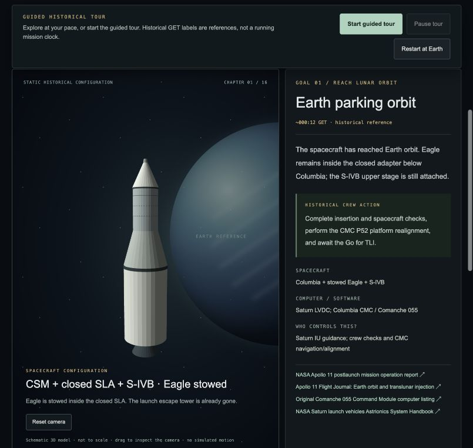
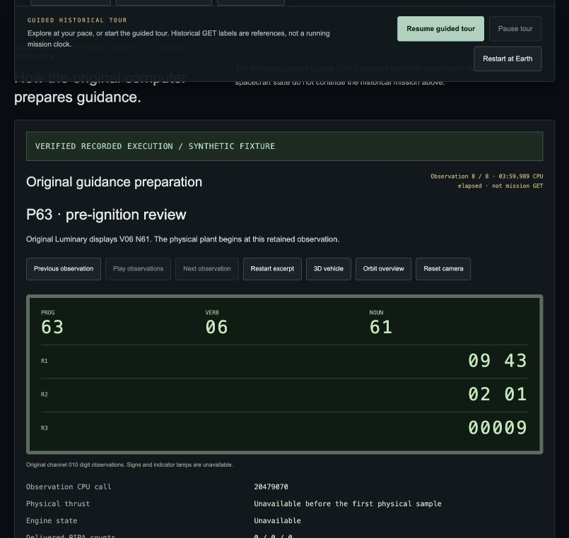

# Earth–Moon–Earth mission reference: verified frontend delivery

Verified on **2026-10-18**, branch **UI/UX**, extending `e243e60` and its merged
backend from `origin/main` at `92adbb5`. The default entry now begins in Earth
parking orbit. This increment supplies chronological historical navigation and
original-execution evidence inspection; it does not establish a complete
original-computer-controlled flight.

## Run

```sh
make play
```

Open **http://127.0.0.1:4173/** → **Historical mission** → **Begin in Earth orbit**.
For the automated historical showcase choose **Guided tour**, then **Start guided
historical tour**, or open **http://127.0.0.1:4173/campaign.html?tour=1**.

Keep the server terminal open. On a fresh installation use
`python3 -B tools/final_demo.py --bootstrap-runtime --port 4173` once. Without
native dependencies use `python3 -B tools/final_demo.py --recorded-only --port 4173`.
The local historical reference, recordings and Python checklist trainer remain
usable. If 4173 already serves this application, reuse it; a second instance can
use `make play PORT=4180`. No npm installation or bundler is needed to play.

## Delivered

- Three historical goals and sixteen cited chapters: Earth parking orbit,
  TLI, Eagle retrieval, coast, lunar arrival, LM activation, undocking/inspection,
  DOI, powered descent, surface, ascent/rendezvous, TEI, coast and direct Earth
  entry/splashdown.
- Eight static 3D configuration references, with a closed SLA/stowed Eagle at
  Earth departure, deployed gear before undocking, an ascent stage without the
  descent stage, and a Command Module without the Service Module at entry.
- Correct separation of Saturn LVDC, Columbia CMC, Eagle LGC and human control
  authority. Historical GET labels remain reference times, never a running clock.
- A guided tour with pause/resume/restart and chapter navigation. Two engineering
  inserts step exact retained original-AGC observations: eight preparation events
  and eighteen engine/feedback events from the same synthetic Phase 12 experiment.
- Original DSKY digit observations, raw source row/cycle/hash, actual physical
  samples when present, and a separate recorded 3D inspector. Unknown signs and
  lamps stay unavailable; no physical state is substituted before its first sample.
- A typed, runtime-validated reference contract. Chapter review never sets a
  flight goal complete. Missing integration is exposed at every stage.
- The existing 28-action undocking trainer, independent shared educational lab,
  Phase 10 explorer and bounded native attitude console are retained.

## Actual automated checks

**432 tests passed, zero failures or skips in the final checks.**

| Check | Result | Evidence |
| --- | --- | --- |
| Frontend Node suite | 261 passed, including 32 new campaign/showcase/model tests | [Log](frontend-js-tests.txt) |
| Frontend Python provenance suite | 42 passed | [Log](frontend-python-tests.txt) |
| Backend regression suite | 129 passed | [Log](backend-tests.txt) |
| `make frontend-check` | Original guidance/propulsion exports verify; all browser modules parse | [Log](frontend-check.txt) |
| `npm --prefix frontend run typecheck` | Existing provider contracts and new campaign declarations pass TypeScript 5.9.3 | [Log](typecheck.txt) |

The backend HTTP tests required loopback access outside the restricted execution
sandbox; they passed when rerun with that access. These checks do not constitute
a new historical trajectory or original-AGC landing validation. No backend source
was changed. The application is static HTML/CSS/ES modules, so there is no separate
bundle build to claim.

## Visible browser verification

The automatic tour was run from Earth parking orbit to entry/splashdown. It
reviewed all sixteen chapters, played both exact original-execution excerpts,
and ended with **“Historical tour complete. No flight was executed.”** The
historical execution control remained disabled. [Captured result](tour-completion.json).

Pausing after observation 2/8 and resuming preserved the same CPU timestamp and
event. Navigating to the undocking trainer and Back left the AGC controls working.
The home screen opened the historical tour correctly; the independent lab still
exposed its existing launch configuration. No new educational lab flight was
presented as original AGC execution.

At **1440 × 1000** and **390 × 844**, the mission page had no horizontal overflow.
The mobile launcher also had no overflow. Browser console checks returned no
warnings or errors. [Structured observations](browser-checks.json).




Additional captures: [desktop page](campaign-desktop.png),
[mobile page](campaign-mobile.png), [mobile launch](launch-mobile.png),
[mobile AGC inspector](agc-mobile.png),
[retained propulsion observations](agc-propulsion.png),
[ascent stage](ascent-stage.png), [entry Command Module](entry-cm.png),
[tour completion](tour-complete.png).

## Preservation and next integration

[The preservation report](preservation.json) compares all 8,778 baseline tracked
files. Ten named existing frontend/documentation/configuration files changed;
the other **8,768 remain byte-identical**. No baseline file was deleted. This
includes original Apollo sources, emulator semantics, backend code, retained
experiment evidence, pinned runtime definitions and existing recorded exports.

Complete historical Earth-orbit initialization, Saturn TLI, CMC navigation,
orbital flight, LM descent/ascent, rendezvous and Earth entry services are absent.
The guided tour cannot supply them. A future backend provider must establish
original execution, authoritative physical state and measured stage outcomes;
capability flags or reviewed chapters alone cannot enable flight completion.

[Chronology and primary sources](../APOLLO11_CHRONOLOGY.md) ·
[integration contract and roadmap](../APOLLO11_CAMPAIGN_INTEGRATION.md) ·
[seven-minute and three-minute judges presentation plans](../JUDGES_PRESENTATION_PLAN.md).
