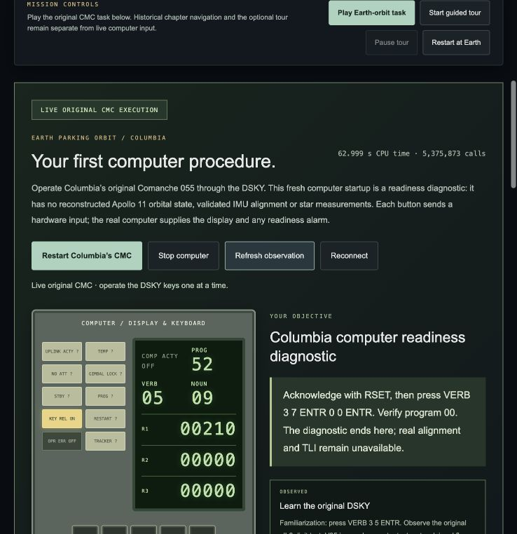
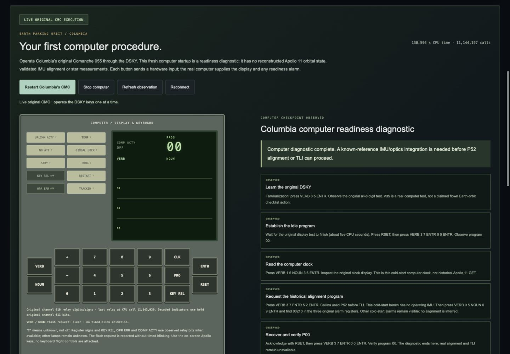
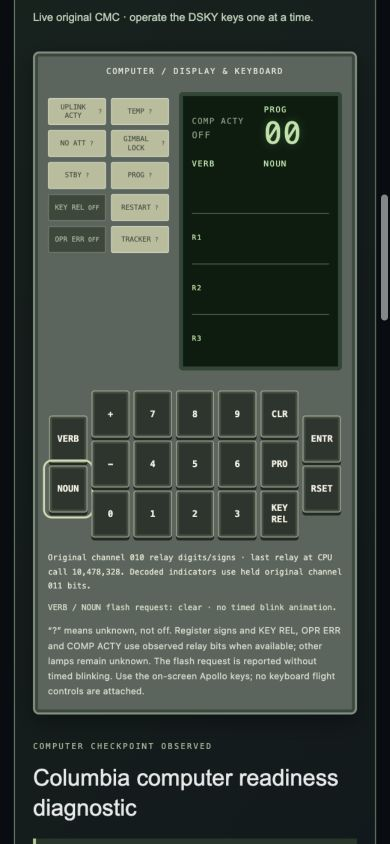

# Playable original Columbia computer: delivery report

The first campaign chapter now has a manually playable original Comanche 055
CMC console. It replaces the default tour-first entry with a computer task:
operate the DSKY, observe the running computer, diagnose its real P52 readiness
alarm, and recover to P00. The 3D configuration and historical chapters remain
available alongside it.

This is a **cold-start computer diagnostic**, not a restored Apollo 11
post-insertion checkpoint. No orbital state, operating IMU, star measurement,
successful alignment, TLI or spacecraft flight is supplied. The task ends at
that actual integration boundary. A complete historical mission remains
unavailable.

## Run and play

```sh
make play
```

Keep the terminal open. Open `http://127.0.0.1:4173/`, choose **Apollo mission**
and **Solo**, then **Open Earth-orbit task**. Direct entry:
`http://127.0.0.1:4173/campaign.html?play=1`.

Click **Start Columbia’s CMC** and follow the next instruction with the nineteen
on-screen DSKY keys. Wait for each step to become **OBSERVED**. Restart creates
a fresh computer and resets only this diagnostic. Stop closes its worker.

The static frontend has no bundler/build step. Python and a C compiler are
needed for live CMC execution; retained inputs build locally on first start.
The existing attitude/propulsion modes retain their separate pinned Tcl
requirements. Node and TypeScript are development checks only. Recorded-only
mode keeps live execution unavailable. Reuse an existing server on 4173, or
start another with `make play PORT=4180`.

[Complete player to-do list and entire-app walkthrough](../EARTH_ORBIT_PLAYABLE_GUIDE.md)
· [implemented routes and integration contract](../EARTH_ORBIT_INTEGRATION.md)
· [historical procedure research](../EARTH_ORBIT_PROCEDURE_RESEARCH.md).

## What changed

- Added retained, source-verified Comanche 055 and an isolated native CMC
  adapter using the unchanged pinned emulator and ringbuffer inputs/outputs.
- Added a serialized service for actual DSKY keys, original output snapshots,
  exact input acknowledgments, lifecycle and server-verified task checkpoints.
  Existing LM and laboratory services remain separate.
- Added a typed client and reusable console panel. Actual relay words supply
  digits, signs and the supported indicators. Unmapped lamps remain unknown.
  No tutorial response is substituted for original software output.
- Made the home-page default open the task. Manual console actions pause the
  optional reference tour. Camera movement sends no spacecraft commands.
- Added input/session, missing-data, output-observation, native, HTTP and
  frontend regression coverage. Uncertain POSTs are never automatically retried.

## Verification performed on 18 October 2026

| Check | Actual result | Retained output |
| --- | --- | --- |
| `python3 -B -m unittest discover -s backend/tests -v` | **166 passed** | [backend log](backend-tests.log) |
| `cd frontend && npm test` | **280 passed** | [JavaScript log](frontend-js-tests.log) |
| `python3 -B -m unittest discover -s frontend/tests -p 'test_*.py' -v` | **42 passed** | [frontend Python log](frontend-python-tests.log) |
| `cd frontend && npm run typecheck` | Passed | [TypeScript log](typecheck.log) |
| `make frontend-check` | Passed: retained exports and module syntax | [check log](frontend-check.log) |
| Original Comanche assembly | Zero errors/warnings; assembled image equals converted proofed octal image | [sealed computer evidence](../earth-orbit-evidence/runs/verified/summary.json) |
| Native repeat / native–WASM | Fresh native traces identical; all 6,915 output tuples match at exact cycles over 3,566,967 calls and 44 input packets | [bounded cross-runtime evidence](../earth-orbit-evidence/README.md) |
| Browser playthrough | All five checkpoints observed through actual UI clicks on the final 4173 server | [DOM observations](browser-completion.json), [actual session log](browser-session-console.jsonl) |
| Responsive layout | 1440 × 1000 and 390 × 844; page widths match viewports; all 19 keys fit | [measured bounds](responsive-check.json) |
| Preservation | 8,796 existing files unchanged; 15 intended application/document edits; no deletion or unexpected change | [baseline hash comparison](preservation-check.json) |

**488 automated tests passed**, including 56 new tests for this milestone.
The final home-page wording/cache-version adjustment also passed module syntax
and the subsequent frontend checks. Backend suites include actual native
Comanche execution, invalid-input rejection, duplicate-key races, failure
cleanup and same-origin/token HTTP checks. Original-output conditions are
tested against negative controls: entering the expected script without its
computer output cannot complete the task.

The native–WASM result covers the DSKY/PRO subset, with its documented
CM-personality limitation. It does not validate a vehicle or IMU model.
Read-only status polling consumes published observations; the owner thread
advances the CPU in bounded slices. CPU time is distinct from historical GET.

### Browser observations

The manual run sent 41 DSKY keys for the diagnostic. The retained session also
includes a subsequent RSET used to verify that manual input pauses the tour,
and the explicit stop. All observations came from the original native process:

1. V35 produced the numerical all-8 test.
2. RSET and V37E00E produced P00.
3. Full V16N36E produced numeric clock registers that changed between samples.
4. P52 followed by V05N09E produced PROG 52, VERB 05, NOUN 09 and `00210` in R1
   in this run. The service also accepts that actual code in R2 or R3.
5. RSET and a fresh V37E00E produced P00 and the diagnostic-completion message.

No console warning/error was captured during the final task check. Keyboard
focus reached the mobile keypad, every button remained within the viewport,
and the optional tour paused on manual input. The temporary responsive
viewport overrides were reset afterward.

### Screenshots







The original display-test observation is also retained in
[01-live-display-test.png](01-live-display-test.png); relay refresh can leave
individual fields between display states in a screenshot. The actual all-8
checkpoint is retained in the unmodified session log.

## Next integration work

1. Establish a reproducible, source-validated post-insertion CMC checkpoint
   through authentic initialization, including known reference orientation.
2. Connect the physical IMU and optics interfaces; validate Collins’s actual
   P52 option-3 star sightings and observed correction result.
3. Integrate authoritative CSM dynamics and Saturn departure control before
   enabling a TLI task. The normal departure burn belongs to Saturn’s LVDC.
4. Continue the existing chronological chapters only as their real control,
   spacecraft and sensor capabilities become available. Keep original CMC/LGC,
   historical references and the separate educational laboratory distinct.

No old Apollo source, emulator semantics or historical experiment evidence was
edited. New original-computer evidence is retained separately from application
code and this frontend report.
