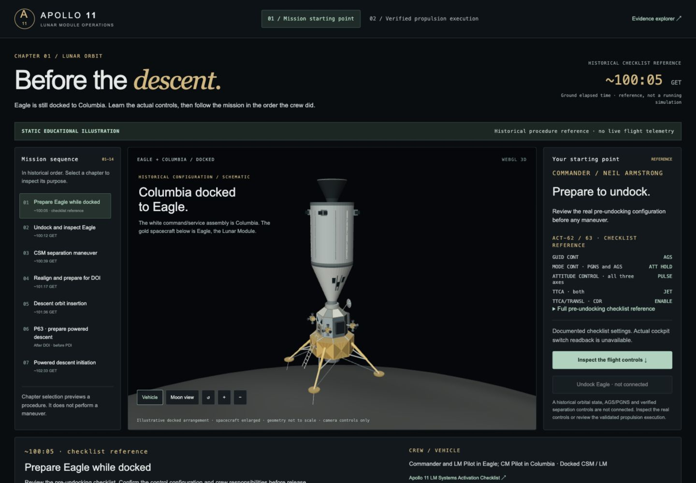
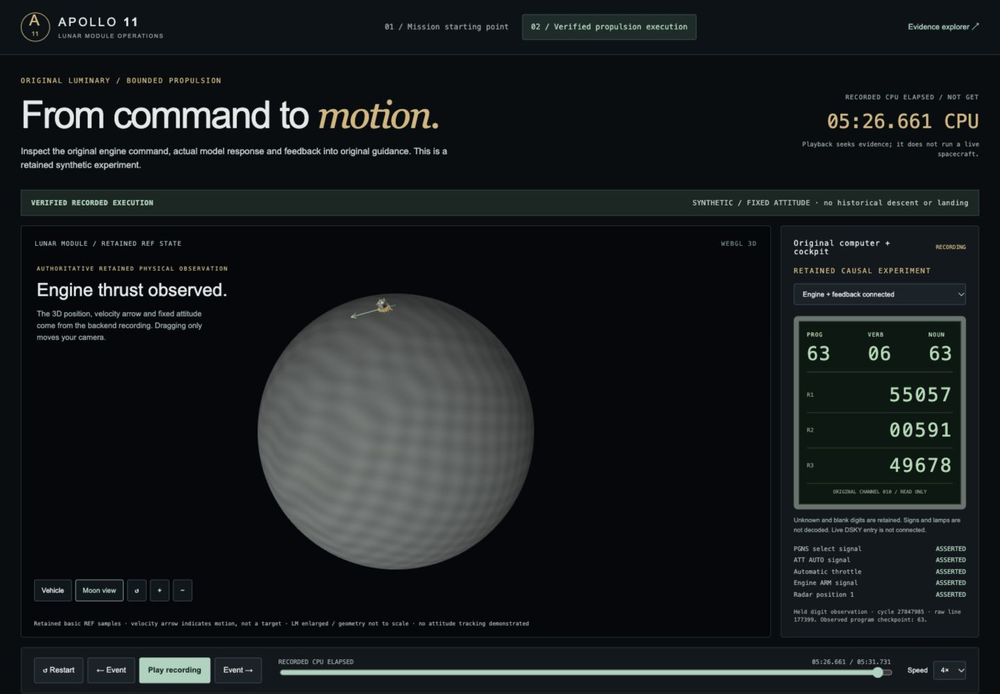
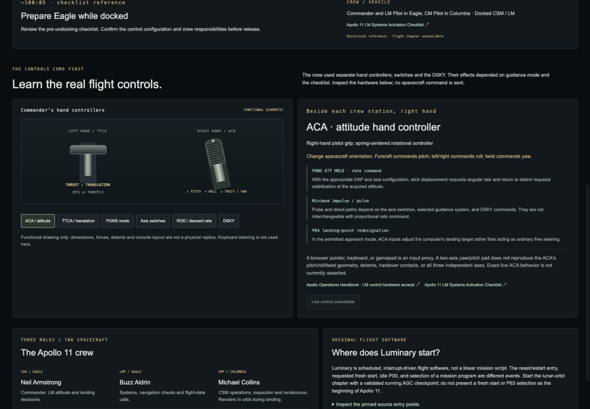

# Mission starting point and 3D propulsion verification

Verified on 2026-10-18, based on the UI/UX merge at
`9202b82ad5ae419bb78d1d606ec5b2ed606acbb6` and retained backend work through
`22bd3c2` (Phase 12). This is frontend verification of retained experiments;
no new historical flight or landing is claimed.

## Delivered behavior

`/play.html` opens before Eagle undocks from Columbia, with source-linked
ACT-62/63 checklist references at scheduled approximately 100:05 GET. It
distinguishes the two spacecraft and all three crew roles, previews fourteen
chronological chapters, and explains six real control families. Hardware drawings
are functional schematics. Historical flight and live cockpit commands are gated.

The separate **Verified propulsion execution** view connects the sealed backend
recordings to 3D position, velocity direction, fixed attitude and actual sampled
path. It exposes the four retained causal cases, original DSKY digits, actual
cockpit discretes, engine commands and response, thrust, fuel, PIPA counts and
original navigation observations. Replay, event stepping, restart, speed and
scrubbing inspect evidence; they do not execute a crew action.

Same-cycle events retain their individual raw-row identities. All **715** exact
event snapshots and their trajectory ceilings are checked. The original crew
review does not prematurely display subsequent hardware packets or physical
initialization. Physical REF and original IMU stable-member navigation are
displayed separately. The velocity arrow indicates direction, not a target.

The synthetic fixed-attitude experiment does not establish achieved burn
attitude, full powered descent, P64/P66, contact or landing. GET, CPU-call elapsed
time and external physical time remain distinct. The older Phase 10 walkthrough
is preserved at `/preparation.html`; the legacy two-axis lab is explicitly a
modern yaw/pitch input proxy, separate from the Apollo controls reference.

## Actual checks

| Command | Result |
| --- | --- |
| `make frontend-check` | PASS: both read-only evidence exports current; browser module syntax valid |
| `make test-frontend` | PASS: 42 Python + 127 JavaScript tests, no failures/skips |
| `python3 -B -m unittest discover -s backend/tests -v` | PASS: 32 tests |
| `git diff --check` | PASS |
| Baseline file comparison | 7,433 existing tracked files compared; only seven intended frontend/build/documentation files changed |

The HTTP regression tests were rerun with normal loopback socket permissions
after the restricted sandbox denied temporary test-server binds. The passing
run is retained in [backend-tests.log](backend-tests.log). Full relevant test and
export output: [frontend-tests.log](frontend-tests.log),
[frontend-check.log](frontend-check.log).

The exporter verifies all **468** sealed release files plus the original rope and
decoder. The derivative browser JSON is **8,113,654 bytes**, SHA256
`68809e065832e07484c1f96816b4c9b32c08d09cdccbc65115e8d8665eb82751`.
The original backend, emulator, Apollo source and historical evidence remain
byte-identical to the starting checkout; see [preservation.json](preservation.json).

Renderer tests include retained-sample quaternion/frame correctness, missing
state, no propagation, camera separation, historical docked composition, and
clearance of the enlarged vehicle mesh above the reference Moon across all
retained physical samples. Geometry remains explicitly not to scale.

## Browser verification

The actual app was inspected through its existing HTTP server on port 4173.
Desktop 1440×1000, tablet 806×900 and mobile 390×844 had no horizontal document
overflow after fixing the mobile chapter-list grid constraint. Temporary viewport
overrides were reset. WebGL rendered the actual retained state; the independent
renderer check also verified the projected Canvas fallback without console errors.

Checked play/pause advancement, the four case outcomes, source/clock labels,
original DSKY, individual same-cycle cockpit packets, unavailable command controls,
control inspection, and chronological previews preserving the docked scene.
The browser console reported no errors or warnings. The provider's rejected-fetch
test verifies unavailable evidence is rejected; the page exposes an error and
keeps recorded-mode controls unavailable when loading fails.

At each case's actual bounded-engine observation, displayed values were:

| Case | Delivered thrust | Fuel | Delivered PIPA X/Y/Z |
| --- | --- | --- | --- |
| Connected | 45.04 kN | 8,079.5 kg | 2379 / 0 / 0 |
| Engine sink | 0.00 kN | 8,196.0 kg | 0 / 0 / 0 |
| Feedback disconnected | 45.04 kN | 8,079.5 kg | 0 / 0 / 0 |
| Connected repeat | 45.04 kN | 8,079.5 kg | 2379 / 0 / 0 |

These are independent retained observations, not historical Apollo 11 telemetry.
See [browser-checks.json](browser-checks.json).

Mobile evidence: [starting configuration](start-mobile.png),
[docked spacecraft](docked-pair-mobile.png), [propulsion view](propulsion-mobile.png),
[control inspection](controls-mobile.png).

## Run and integrate

Open the running app at <http://127.0.0.1:4173/play.html>. For a fresh recording-only
server, run `python3 -B frontend/serve.py --replay-only --port 4173`. For the
existing optional native attitude service, use `make play`. If the port already
serves the app, reuse it; otherwise use port 4180 consistently in command and URL.

[Mission architecture, existing APIs, missing contracts and roadmap](../FRONTEND_MISSION_START.md).
[Apollo sources, checklist and software entry research](../FRONTEND_APOLLO_OPERATIONS.md).
