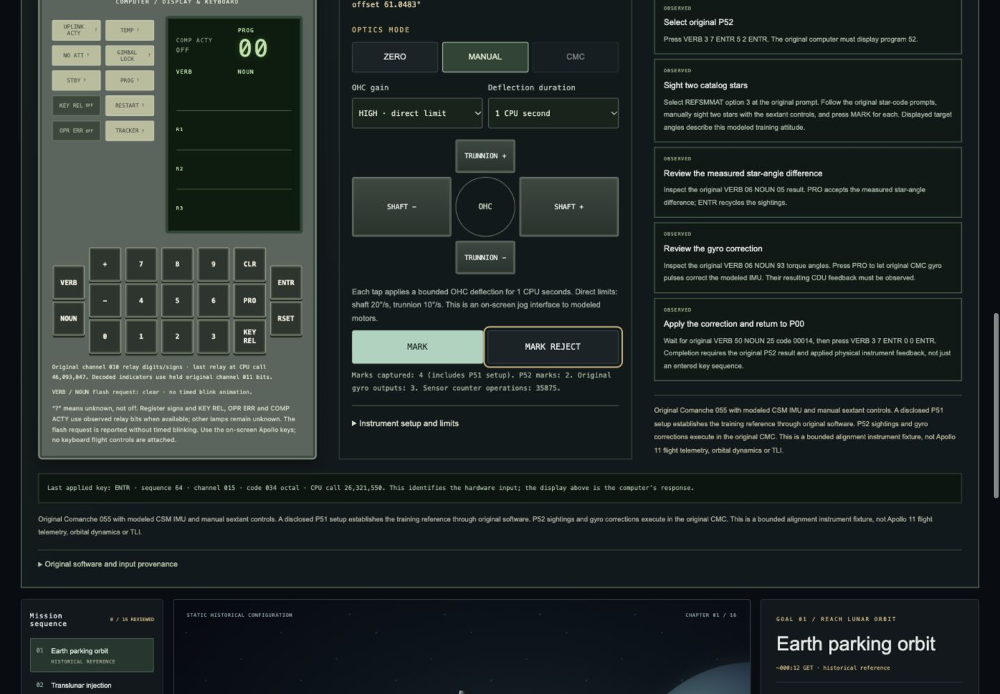
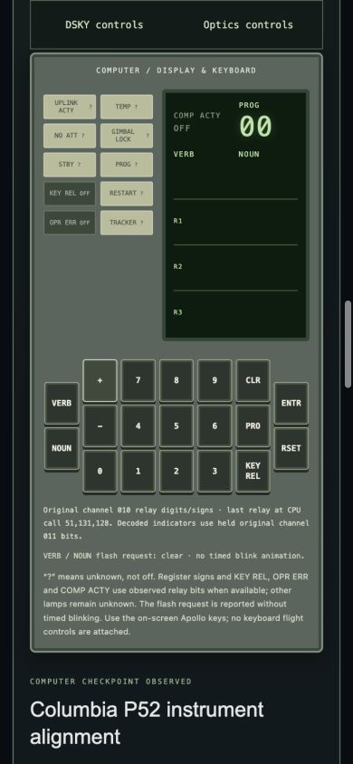

# Playable original P52: delivery and visual verification

Delivered 18 October 2026 on `UI/UX`. The user chose **original-code execution
only; finish alignment first**. This milestone therefore completes original
Comanche 055 P52 with modeled CSM instruments. It adds no reconstructed Saturn
guidance, TLI animation or flight-completion claim.

## Play

```sh
make play
```

Keep the terminal open and use
`http://127.0.0.1:4173/campaign.html?play=1&stage=earth-parking`.
Reuse the running app if 4173 is occupied, or start a separate instance with
`make play PORT=4180`. The home page's Apollo mission entry opens the same task.

Click **Prepare alignment instruments**. A fresh original P51 setup obtains
the training reference through actual modeled optical inputs; it is not a
prerecorded replay or a host-written reference matrix. The player then uses
DSKY, manual optics, star identities, MARK and PRO to complete original P52.

See [the exact player checklist](../P52_PLAYER_GUIDE.md) and
[implemented integration contract](../EARTH_ALIGNMENT_INTEGRATION.md).

The frontend is static and needs no bundler. This live task needs Python and
a C compiler; it builds from retained source without Node, Tcl, remote model
services or network downloads. Existing lunar laboratory modes retain their
own dependencies. Recorded-only mode disables live P52.

## Implementation

- A separate native CMC worker and bounded external CSM instrument model
  consume original instructions, gyro outputs and actual hardware inputs.
- An independent serialized alignment service exposes strict DSKY/instrument
  routes while keeping old CMC, LM and teaching-laboratory services independent.
- A typed client validates source, native clock, relay fields, provenance,
  geometry, completion evidence and acknowledgements. Uncertain mutations
  resynchronize observation without retrying a key or MARK.
- The existing authentic DSKY component is reused. A navigation station adds
  a backend-derived star diagram, manual OHC deflections, optical mode controls,
  MARK/REJECT and actual instrument-observation counts.
- Desktop DSKY stays beside the scrolling optics controls. Mobile station
  shortcuts switch between the DSKY and optics without sending hardware input.
  Manual actions pause the optional historical tour.
- The prior cold-start alarm diagnostic remains separately selectable.

## Actual verification

| Check | Result | Evidence |
| --- | --- | --- |
| Full backend `unittest discover -s backend/tests -v` | **201 passed** | [backend log](backend-tests.log) |
| Frontend `npm test` | **303 passed** | [JavaScript log](frontend-js-tests.log) |
| Frontend Python `unittest discover -s frontend/tests -p 'test_*.py' -v` | **42 passed** | [Python log](frontend-python-tests.log) |
| Frontend `npm run typecheck` | Passed | [TypeScript log](typecheck.log) |
| `make frontend-check` | Passed: retained exports and every module's syntax | [static check log](frontend-check.log) |
| Native P52 integration and causal controls | 14 native tests; eight fresh runs; exact connected replay | [separate sealed native evidence](../earth-departure-evidence/README.md) |
| Browser play | All five player checkpoints observed through real UI input | [DOM observations](browser-completion.json), [actual session log](browser-session-console.jsonl) |
| Responsive bounds | No page overflow at 1440 × 1000 or 390 × 844; all 19 keys within mobile viewport | [DOM measurements](responsive-check.json) |
| Preservation | No unexpected existing-file change or deletion | [baseline hashes](preservation-check.json) |

**546 automated tests passed**, including 58 added for this milestone.
The HTTP coverage includes same-origin/token protections, strict schema,
nonfinite/duplicate input rejection and exact shared key/control sequencing.
Frontend regressions cover conflicting source claims, false completion,
wrong acknowledgements and lost/unreadable mutation responses. Projection
tests use analytic geometry rather than reproducing implementation arithmetic.

### Manual browser playthrough

The complete playthrough used the QA server on **4187**. The final main server
on **4173** was then restarted with the current implementation, its native
setup and live DSKY acknowledgements were checked, and a fresh P00 session was
prepared for the player. The QA server and its owned native process were closed.

The operator selected P52 option3, entered original octal star identities
30/37, took two real MARK inputs, and used nine OHC taps to reach shaft 104.4°
for Nunki. The observed sighting offset was approximately 0.0013°. This is a
manual instrument interaction, not an angle-snap or automatic acquisition API.

This browser run produced original N05 **+00001** (0.01°), then N93
**−00002, −00010, +00009** (−0.002°, −0.010°, +0.009°).
After PRO, three actual gyro outputs drove the model and returned sensor
operations. Original V50N25/00014 preceded the intentional final P00 request.
All five player checkpoints became OBSERVED. The newly computed results differ
from the exact-angle retained native run, which is expected for different marks.
[The torque-review observation](torque-review.json) retains the displayed values.

The navigation guide, instrument values and five task observations were checked
on desktop/mobile. Keyboard focus and mobile station links worked. No browser
warning/error was captured in the final check. Temporary viewport overrides
were reset; the normal-sized main app remains open.





## Limits and next steps

This is original P52 computation with a **constructed stationary attitude and
ideal bounded instruments**. Original P51 computes its starting reference. It
is not a restored post-insertion checkpoint, historical star encoder data,
calibrated physical IMU or Earth-orbit propagation. The completed fixture does
not grant a TLI capability. The user explicitly chose to keep departure gated.

The actual original Apollo and emulator source remain unchanged. The new
external MARK adapter requests the documented hardware interrupt missing from
the pinned ringbuffer path; it does not edit flight RAM or instruction semantics.
The new integration has native repeat/causal evidence, **not a new WebAssembly
equivalence result**. Earlier DSKY-only WASM findings retain their earlier scope.

Next work: restore and validate a mission-specific CMC checkpoint; broaden
sensor calibration, visibility and physical instrument fidelity; then obtain
the correct original Saturn provider and its vehicle/peripheral integration
before offering departure. The independent modern LM laboratory remains a
separate educational experience.
