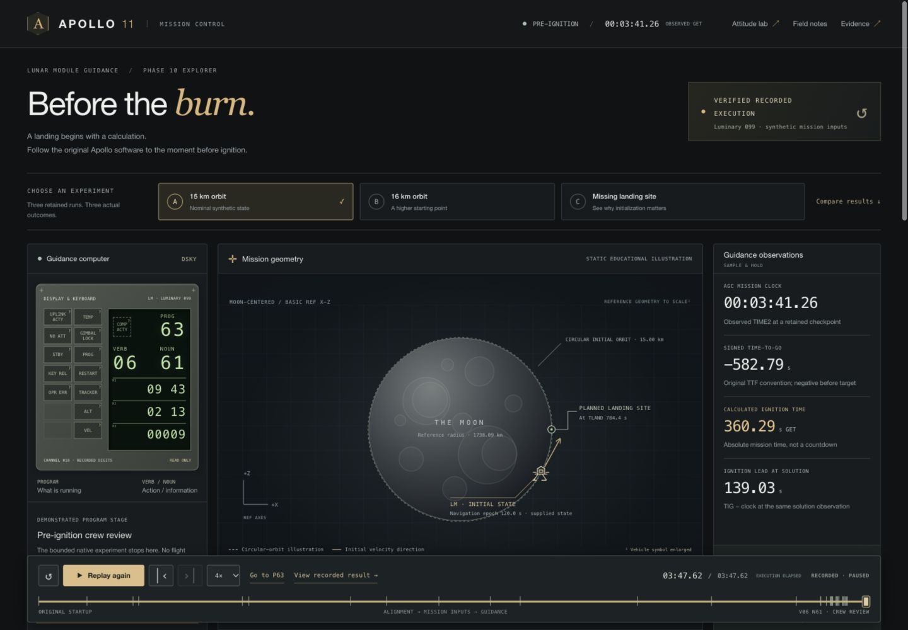

# Phase 10 frontend MVP — implementation and verification

Date: 2026-10-18 (Asia/Tbilisi). Branch: `UI/UX`.
Baseline: `5a689c7` (`Add verified educational pre-ignition guidance replay`).

## Result and scope

The existing static guidance frontend is now a responsive Apollo-inspired mission
console with independently reusable DSKY, spacecraft-view, scenario comparison,
crew, and capability components. A small checked JSDoc/TypeScript domain layer
separates display data from emulator implementation. The established exporter,
launcher, loopback server, and earlier attitude console are reused.

All three results come from the existing verified Phase 10 export:

| Scenario | Original recorded result |
| --- | --- |
| Synthetic 15 km orbit | Nine normal roots; TIG **360.29 s GET**; V06 N61 crew review |
| Synthetic 16 km orbit | Nine normal roots; TIG **360.44 s GET**; V06 N61 crew review |
| Missing landing site | Three provisional results, original **01406**, no completed TIG |

Playback holds real observations. The spacecraft graphic is a static projection
of initialized 3D inputs, with separate spacecraft/site epochs and scale limits.
It is never animated as an unexecuted trajectory. DSKY digits/blanks are authentic
recorded relay output; lamp and sign states remain explicitly unavailable.
Crew roles are exactly Armstrong, Aldrin and Collins, clearly planned; Collins's
position remains the Command Module in lunar orbit.

**Not implemented or claimed:** live mission guidance, arbitrary live DSKY input,
engine ignition, translational burn physics, powered descent, landing, multiplayer,
AI astronauts, or AR. The existing live yaw/pitch API remains separate and unchanged.

## Run

From the repository root:

```sh
python3 -B tools/demo/demo.py launch
```

Open **http://127.0.0.1:4173/guidance.html**. Python 3.9+ is sufficient. No install
or frontend build is required. For another port, append `--port 4180` and open
**http://127.0.0.1:4180/guidance.html**. The launcher verifies/export-checks original
artifacts before starting the replay-only server. Ctrl-C stops it.

See [architecture, components, exact checks and roadmap](../FRONTEND_ARCHITECTURE.md)
and [verified APIs and missing integration surfaces](../FRONTEND_INTEGRATION_CONTRACT.md).
The frontend development preview used port 4186. The failure fixture used 4187;
its first JSON request deliberately returns 503, then Retry serves the unchanged
real dataset. It is a separate QA harness, not a product/backend endpoint.

## Actual tests and static build validation

Environment: macOS 26.4.1 arm64; Python 3.11.8; Node v24.10.0. No new packages were
installed. The optional type checker was already in repository-local node_modules.

**118 unique focused tests passed, zero failures or skips.** Existing Node tests
run inside `make test-live` are also present in the 54-test JavaScript total and
are counted only once. These are unit/data/HTTP contract tests, not new native
flight experiments.

| Actual command | Result |
| --- | --- |
| `node --test frontend/tests/*.test.mjs` | **54 passed**; retained [output](javascript-tests.txt) |
| `python3 -B -m unittest discover -s frontend/tests -p test_guidance_data.py -v` | **14 passed**, including actual raw/compressed source hashes, DSKY packets and deterministic export |
| `make test-live` | **32 backend Python**, **12 replay Python**, **22 Node** passed; Node group included in 54 above |
| `python3 -B -m unittest discover -s tools/demo/tests -v` | **6 passed** |
| `make frontend-check` | **exit 0**; export matched **2,736,537 bytes**, SHA-256 below; every served `.mjs` passed `node --check` |
| `python3 -B tools/demo/demo.py verify` | **exit 0**; 739 sealed Phase 10 files, rope and canonical trace hashes verified |
| Optional provider `tsc --noEmit --allowJs --checkJs ...` command in architecture | **exit 0**; domain contract checked without emitting files |
| `git diff --check` | **exit 0** |

The app is a static served artifact, so there is no webpack/Vite/React build to
report. `make frontend-check` is its reproducible artifact/syntax verification.
`make test-frontend` now provides a single entry point for the 26 Python frontend
checks plus all 54 Node tests; its constituent commands were exercised above.

The historical full Phases 2–7/native `make check` was not rerun for this UI change.
Earlier reports retain their known missing historical evidence errors; this report
does not relabel those as passes. No new native ignition/descent execution ran.

## Browser verification

[Browser readbacks and assertions](browser-checks.json) retain 15 final passing
assertions, actual displayed values, and intermediate observations. They cover:

- All three scenarios, actual DSKY result fields, distinct TIG results and missing-site failure.
- Replay advancement, explicit play/pause, restart, event stepping, native keyboard range scrubbing, speed selection and final-result navigation.
- Geometry unchanged through playback; separately labeled epoch/projection disclosure and 3D state readout.
- Comparison navigation selecting its own original scenario result.
- Trace fingerprint/provenance dialog and exactly three planned crew positions.
- An intentionally unavailable recording: unknown telemetry, disabled controls, settled `aria-busy`, and recovery by Retry.
- Desktop layouts at 1440×1000 and 1280×900; phones at 390×844 and 360×800; final document width equals viewport width.

An initial narrow-screen overflow was observed and retained in the JSON: an
absolutely positioned screen-reader table heading escaped its scroll container.
Adding a containing block corrected it. Both phone widths were checked again.
Final normal-console browser error logs were empty. The separate failure fixture
intentionally generated HTTP 503; that expected response is not hidden as a pass.

Testing used the Codex in-app browser. A separate Chrome/Firefox/Safari engine
matrix, physical iPhone testing, and AR were not run. Screenshots demonstrate UI,
not spacecraft flight or fresh native numerical proof.



[1280 desktop](screenshots/desktop-1280.jpg) ·
[16 km](screenshots/desktop-16km.jpg) ·
[missing-site control](screenshots/desktop-missing-site.jpg) ·
[phone overview](screenshots/mobile-top.jpg) ·
[phone geometry](screenshots/mobile-geometry.jpg) ·
[phone DSKY](screenshots/mobile-dsky.jpg) ·
[unavailable recording](screenshots/unavailable-recording.jpg)

## Preservation and provenance

[The preservation receipt](preservation.json) compares **5,504 pre-existing tracked
files** in `docs/`, `backend/`, `tools/`, and `AGENTS.md` against fingerprints taken
before frontend work. **Zero changed or missing.** No original experiment record,
Apollo source bundle, emulator instruction semantics or backend implementation
was edited. Newly authored reports and QA evidence live in this separate directory.
The README, Makefile and frontend edits are intentional application/documentation
changes and are outside that protected scientific/backend inventory.

The export is byte-identical to baseline:

```text
frontend/dist/data/guidance.json
36d380a5274312621145d3549a161fea7040d269c549738239ac4e7dabf52709
```

Canonical raw trace hashes, checked by the unchanged launcher:

```text
A and repeat  6fe0d3c6ee46639c82d9c563925f206324325bc14bdabb5a3f4c6293c8085bc2
B             34540f19cf0b19284d2d15add4043da854a528625e31a84af30aee4660259eb4
C             432f74373968b1040c35b5dd3e7e1365c8aa13561e75d07b1d4e0ced02355bc9
```

[Validation results](validation.json) and [file checksums](checksums.json) accompany
this report. All original reports/manifests remain the scientific record for their
own frozen revisions. This package describes frontend presentation and integration.
