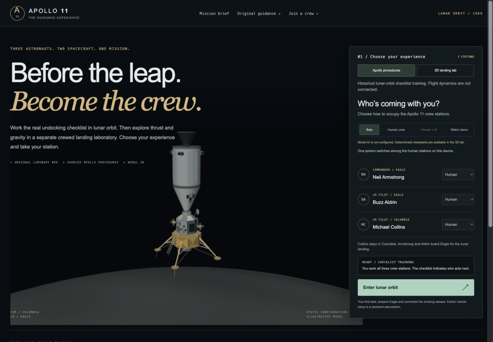
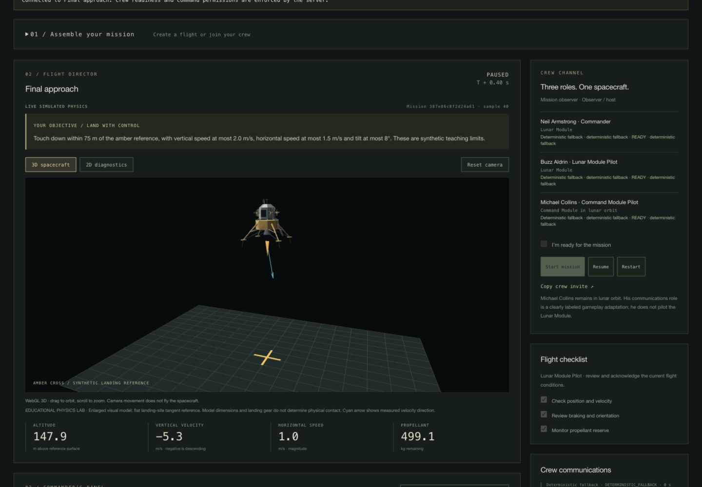
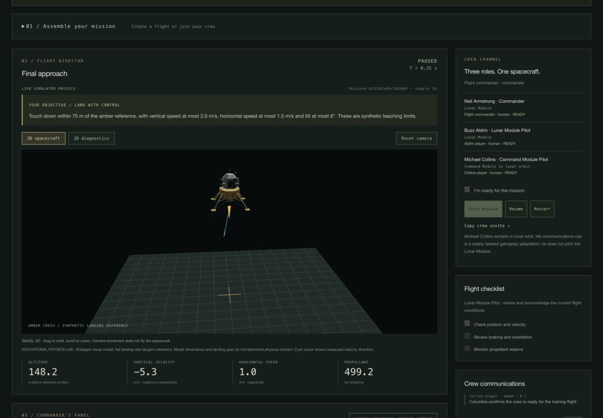
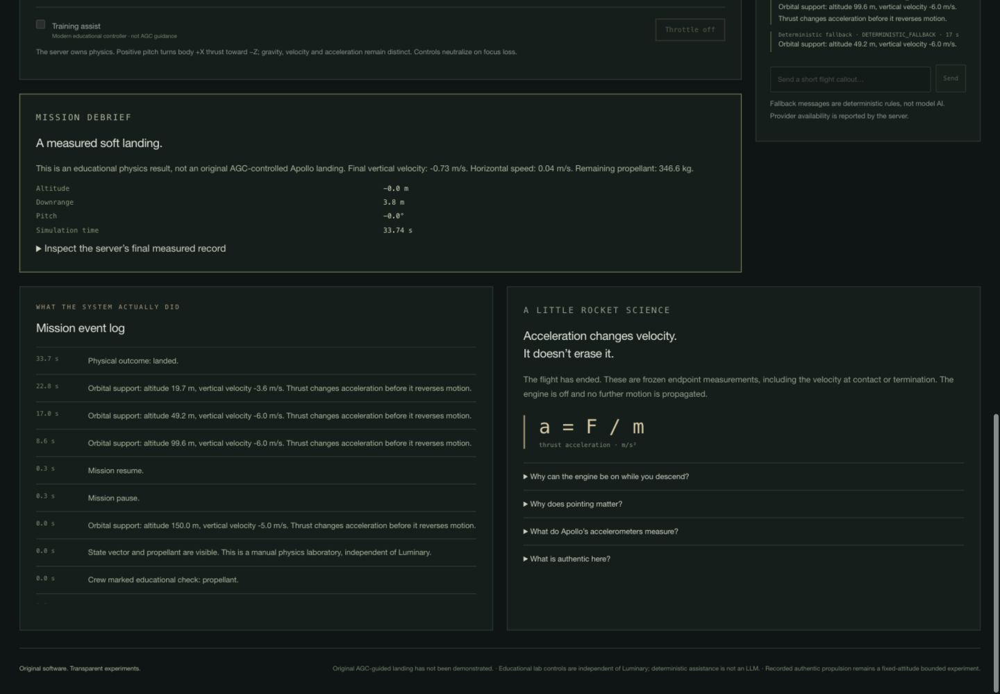
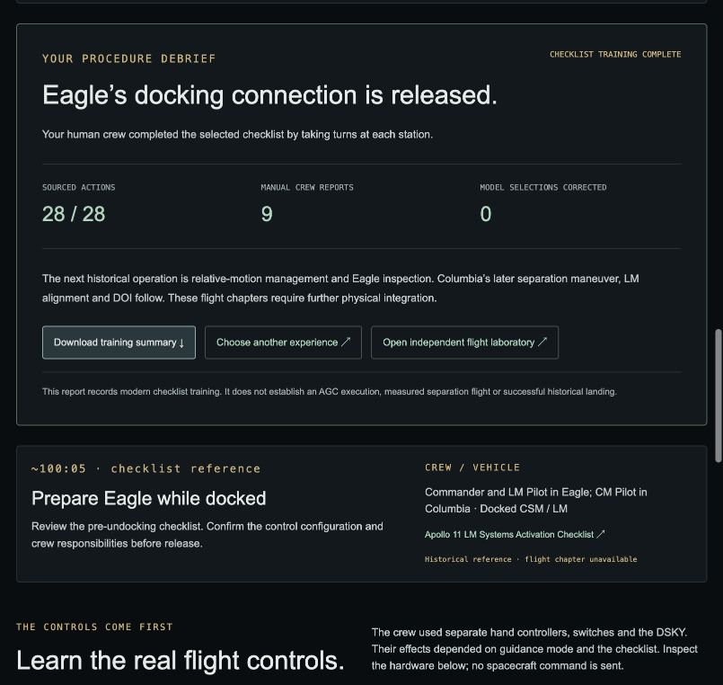

# Unified Apollo product — release verification

Verified 2026-10-18 on `UI/UX`. Fetched final backend `92adbb5` from `origin/main`
is included through merge `daffe51`. Both previous frontend commits and the
source-backed undocking trainer were preserved.

## Run the product

```sh
make play
```

Open **http://127.0.0.1:4173/**. On a new checkout, use
`python3 -B tools/final_demo.py --bootstrap-runtime` once to prepare the locked
native dependencies. Without those dependencies, the launcher keeps the
Python-only checklist and authentic recordings available. Use `PORT=4180` for a
second instance; no existing process is automatically stopped.

[Submission guide and three-minute demo](../SUBMISSION_GUIDE.md),
[implemented mission API](../FINAL_INTEGRATION_CONTRACT.md),
[historical procedure contract and sources](../FRONTEND_UNDOCKING.md).

## Delivered flow

The new home screen chooses **Apollo procedures** or the separate **3D landing
lab**, then the crew composition. Historical procedures support one player
switching stations or humans taking turns on one device. The flight lab uses
the real shared-mission backend: exactly three human, deterministic assistant or
configured model seats, with an optional observer host. Human clients join by
mission ID/invite; readiness, command permissions, messages and measurements are
server-owned. The Watch demo preset selects three deterministic assistants.

AI is not simulated by the interface. Model options require the actual
`llmConfigured` capability. No real external model provider was configured or
run during this release. Provider protocols and failures were tested with
stubs; deterministic assistance remains explicitly labeled.

The default flight viewer is now WebGL 3D, with Canvas projection fallback and
the retained 2D diagnostic. It renders server position, velocity, orientation
and delivered thrust. Camera interaction never commands the plant. The visible
objective comes from the server's synthetic touchdown thresholds. Modern
keyboard steering requires explicit opt-in.

The historical checklist follows selected documented controls through Collins's
EXTD/REL and OFF actions, then hands off to inspection. It now has a completion
debrief and downloadable modern training receipt. It does not execute the AGC,
measure physical undocking or unlock unsupported flight chapters.

## Automated results

**400 tests passed; zero failures or skips.**

| Check | Actual result | Output |
| --- | --- | --- |
| Backend unittest discovery | 129 passed | [Log](backend-tests.txt) |
| Frontend Node tests | 229 passed | [Log](frontend-js-tests.txt) |
| Frontend Python provenance tests | 42 passed | [Log](frontend-python-tests.txt) |
| `make frontend-check` | Retained exports verified; all modules parse | [Log](frontend-check.txt) |
| `npm --prefix frontend run typecheck` | PASS with lockfile-pinned TypeScript 5.9.3 | [Log](typecheck.txt) |
| `python3 -B -m backend.propulsion_recording --check` | Raw observations exact; local export byte-identical | [Log](propulsion-export-check.txt) |

Backend checks include physical outcome repeatability, live Tcl plant behavior,
three-client HTTP coordination, crew permission and model-stub matrices,
malformed input, command leases, stale run IDs and all previous native/procedure
tests. The Python-only undocking path is tested even without native assets.

Frontend checks include source provenance, mode separation, actual API schemas,
crew combinations, model gating, immutable reports, held observations, timeout
and uncertain-command recovery, and geometry-wide camera framing at desktop and
mobile aspect ratios. These results do not establish historical flight fidelity.

## Browser results

All actions below used the visible browser interface:

- The lobby gates unavailable model AI and permits the supported human/assistant configurations.
- Watch demo creates an observer-hosted mission with exactly three assistants.
- An assistant flight reached a measured soft landing at **33.74 s**, vertical
  velocity **−0.73 m/s**, horizontal speed **0.04 m/s** and **346.6 kg** propellant.
- Start, pause, resume and restart use authoritative mission lifecycle state.
- Three separate tabs joined Armstrong, Aldrin and Collins. All three had to
  be ready; Aldrin and Collins could not use commander throttle controls.
- Aldrin's checklist report and Collins's communication appeared in the shared
  commander console. All three clients showed the same paused simulation time.
- Manual commander throttle requested **100%** and the server reported
  **45,040 N** delivered thrust. Keyboard shortcuts were off by default.
- Reload restored the authenticated tab's shared mission.
- 3D and 2D views switched correctly. At **390 px**, launch and flight pages had
  no horizontal overflow and the complete spacecraft remained visible.
- The historical shared-device configuration carried into the checklist. All
  **28 actions** completed, producing the correct debrief with **9 manual crew
  reports**. The training receipt download was invoked.
- Historical training was restarted to **0/28** for the player. The final home
  screen was ready, and its final reload produced no console warnings/errors.

[Structured browser observations](browser-checks.json).

## Screenshots







Mobile: [Launch](launch-mobile.png), [crew selection](crew-mobile.png),
[3D flight and goal](flight-mobile.png).

## Preservation and known limits

[Preservation report](preservation.json) fingerprints all baseline tracked files
and confirms **7,230 protected original files unchanged**: Apollo software,
emulator/harness evidence, retained experiments, pinned runtime instructions and
existing native/procedure implementation. The old index attitude console is
preserved byte-for-byte at `/attitude-replay.html`.

The conflicting propulsion formats are separate: the original four-case UI
export remains `propulsion.json`; the backend's three-case raw-derived export is
`propulsion-lab.json`. Export verification compares raw recorded values, source
hashes, cycles, types and ordering exactly. Only six explicitly derived display
projections may vary by at most eight ULP across platforms; source measurements
are never relaxed. This machine's final export had zero differences.

The educational landing laboratory is independent of Luminary. The historical
sequence remains undocking → inspection → CSM separation → alignment → DOI →
P63 preparation → descent. Missing physical historical chapters stay gated.
No verified original-AGC-guided Apollo landing, complete CSM model, voice link,
internet authentication or persistent mission recovery after server exit is
claimed. The shared server binds to loopback; this is the local hackathon build.
