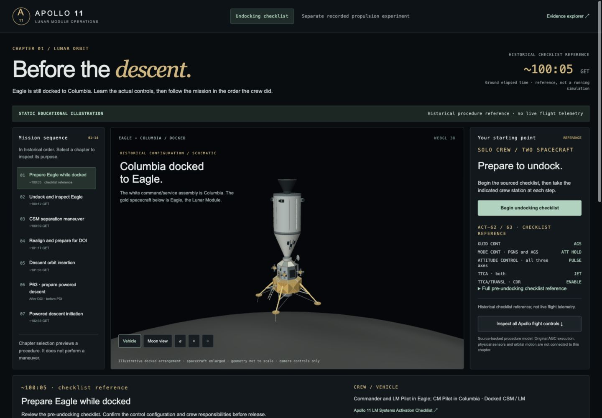
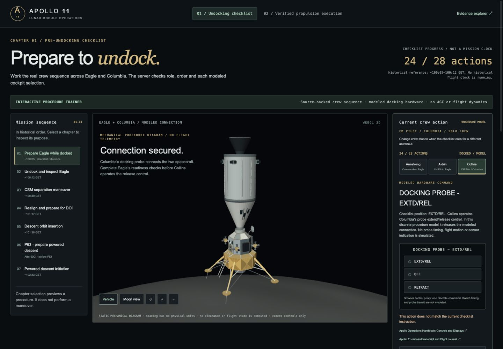
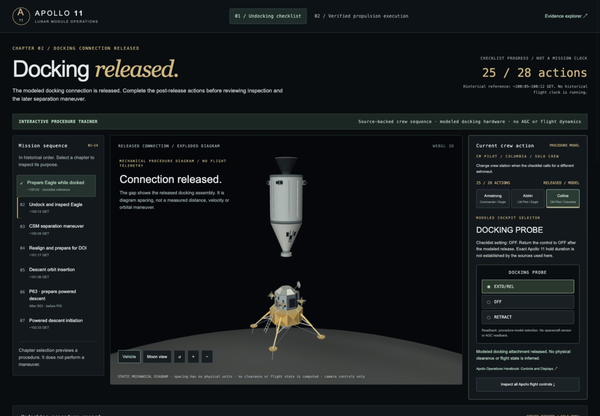
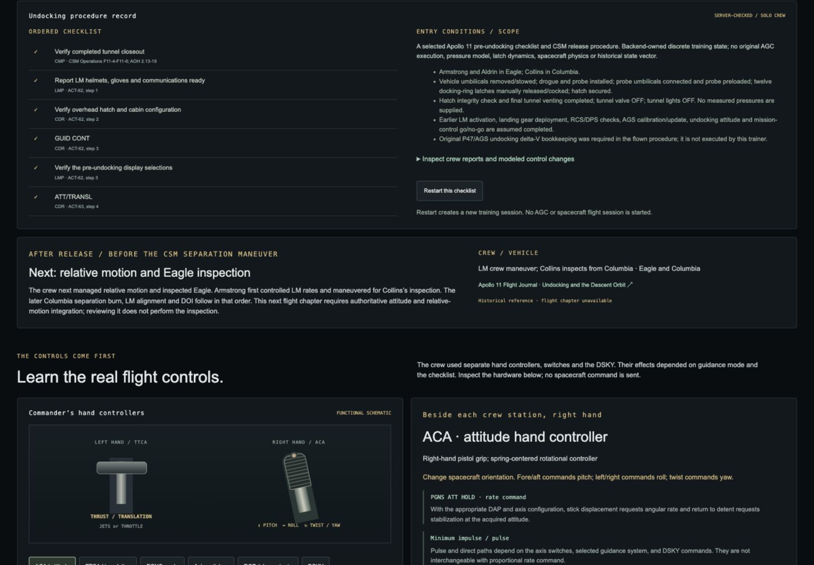
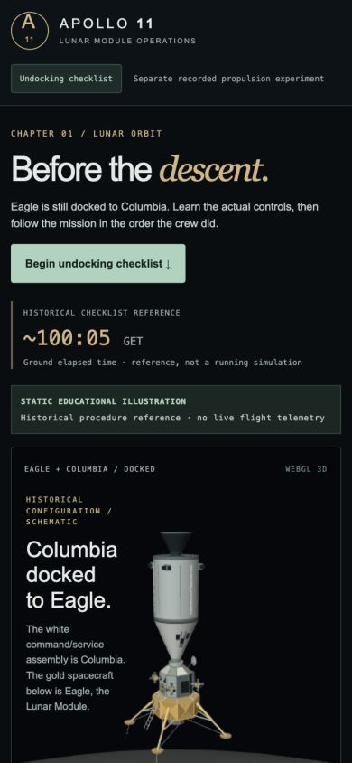
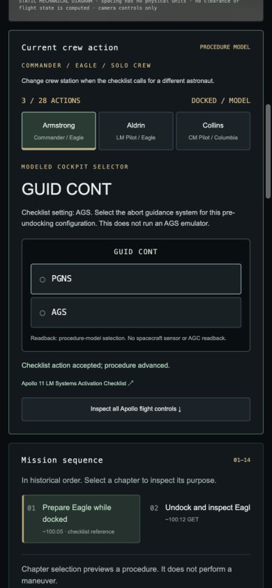
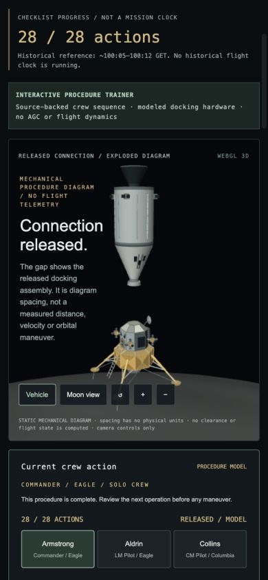

# Playable Eagle undocking — verification

Verified on 2026-10-18 on branch `UI/UX`. This milestone implements a selected
**interactive procedure trainer**, not an original AGC/AGS undocking execution or
historical relative-flight simulation.

## Run and play

```sh
python3 -B frontend/serve.py --port 4173
```

Open **http://127.0.0.1:4173/play.html**, select **Begin undocking checklist**, and
select the indicated astronaut's crew station. Complete the reports and labeled
switch settings in order. Collins commands Columbia's **DOCKING PROBE EXTD/REL**
and then **OFF**. The final reports hand off to inspection, before the later CSM
separation maneuver, LM alignment and DOI. This next physical chapter remains
unavailable.

The checklist starts after explicitly assumed tunnel, hatch, pressure, probe,
latch and computer preparation. Some LM assignments to CDR/LMP are instructional;
vehicle/control ownership and the CMP release operation follow the sources.
No arbitrary joystick/keyboard maneuver or invented flight state is involved.

[Implementation and HTTP contract](../FRONTEND_UNDOCKING.md),
[page-specific historical sources](../FRONTEND_UNDOCKING_RESEARCH.md).

## Automated checks

**258 tests passed** across the frontend and backend suites, with no failures or skips.

| Command | Actual result |
| --- | --- |
| `make frontend-check` | PASS: both retained exports match; every frontend module parses |
| `python3 -B -m unittest discover -s frontend/tests -p 'test_*.py' -v` | 42 passed |
| `node --test frontend/tests/*.test.mjs` | 158 passed |
| `python3 -B -m unittest discover -s backend/tests -v` | 58 passed |

Logs: [frontend export/syntax](frontend-check.txt),
[frontend Python](frontend-python-tests.txt),
[frontend JavaScript](frontend-js-tests.txt), [backend](backend-tests.txt).

Backend tests include real loopback HTTP boundaries, the complete retained
28-step definition, wrong crew/order/revision/sequence, wrong switch selections,
release/OFF order, replay-only rejection and no calls to native controls.
Client tests cover the actual Python service's snapshot shape, acknowledgments,
immutable state, command serialization, timeout/conflict reconciliation, expired
token lock/reconnect, and disabled/missing backend capabilities. Presentation
tests verify that the diagram never supplies flight telemetry.

These checks do not start a native AGC or establish historical flight fidelity.

## Browser walkthrough

The entire 28-action path was played through the visible browser controls:

- Wrong station disables the current action. Reload restores the same server session.
- Selecting PGNS at the GUID CONT step leaves progress at 3/28; AGS advances it.
- All selected reports and switch settings reach the release step at 24/28.
- Selecting OFF at that release step leaves the modeled connection docked.
- Collins's EXTD/REL command changes only the modeled attachment to released;
  the next required action is OFF. The renderer shows a static exploded diagram.
- The LMP release report and CMP inspection handoff complete 28/28. The next
  briefing is relative motion and Eagle inspection, preceding CSM separation.
- Reload restores completion. Switching to the independent recorded propulsion
  experiment preserves its verified mode and original P63 DSKY display.
- At 390 px width, the page has no horizontal overflow; the mobile begin action,
  crew stations and GUID CONT selector work. The released assembly remains visible.
- Restarting the idle server invalidates the old browser token. The attempted
  action is rejected, controls lock and no command repeats. Explicit reconnect
  restores the fresh server's idle state and enabled Begin button.

The native service remained `idle` with no frame after this walkthrough. The
final page reload had no captured console warnings or errors. The server was
left running with a fresh, unstarted checklist for the player.

[Structured browser observations](browser-checks.json).

## Screenshots

Desktop start:



Release control and return to OFF:




Correct chronological handoff:



Mobile checks:





Earlier walkthrough captures precede final wording and docked-camera refinements;
the final start captures show the delivered entry screen.

## Preservation and remaining integration

[Preservation report](preservation.json) checks all 7,462 baseline tracked files
and the existing-file diff against an explicit frontend/server/documentation
allowlist. No original Apollo software, emulator semantics, historical harness
or captured backend experiment evidence was changed. Retained guidance and
propulsion exports also passed their independent provenance checks.

The server adds three documented `/api/procedure/*` routes. It records modern
training actions in RAM and never invokes the AGC. Existing native endpoints
retain their bounded yaw/pitch scope. Sessions are lost on server restart.

Next integration requires authoritative relative motion and attitude authority
for inspection, followed by separate CSM maneuver integration, LM alignment/DOI,
and validated powered descent. Checklist completion cannot unlock these missing
physical capabilities. Multiplayer and AI crew remain unavailable.
